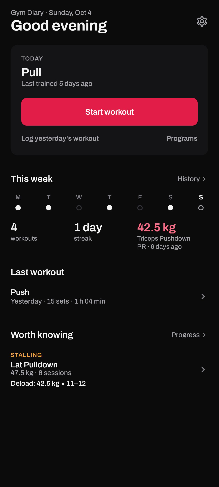
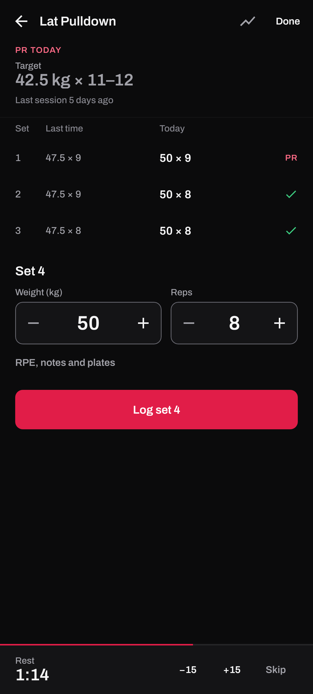
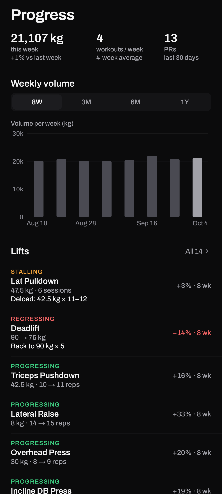
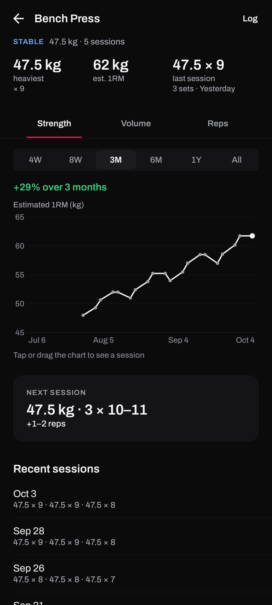
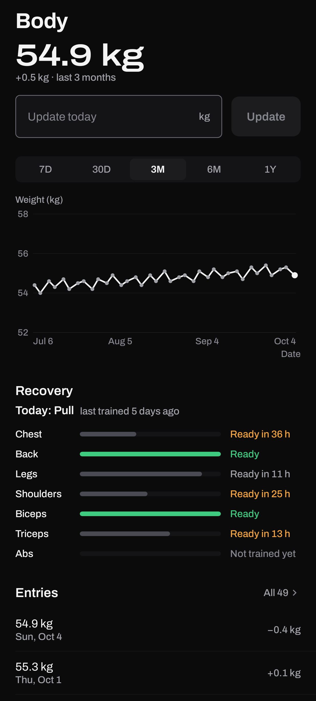
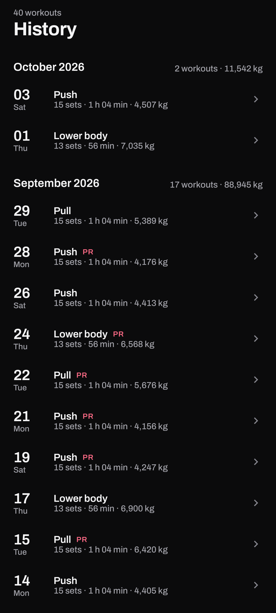

# Owl Fitness

A focused workout log for Android. Log sets quickly, see exactly what to lift next, and
track progress with honest, clearly labelled charts. Everything stays on the device.

<p>
  
  
  
</p>
<p>
  
  
  
</p>

## Features

**Logging**
- Start a workout in one tap; exercises suggested for today's split are one more tap away
- A set logger that shows last session's sets beside today's and pre-fills the next target
- Steppers or direct entry for weight and reps, plus RPE, notes, assisted sets and a plate calculator
- A rest timer that starts after each set, with ±15 s adjustment and skip
- Personal records detected as you log, with haptic feedback

**Progressive overload**
- Every lift is classified as progressing, stable, stalling or regressing
- A concrete next set for each lift: double progression within the lift's own rep range,
  more weight once the top of the range is reached, and a deload after a long stall
- Lifts that need a change are listed first

**Progress and history**
- Weekly volume, workouts per week and recent personal records at a glance
- Exercise detail with Strength (estimated 1RM), Volume and Reps charts, ranges from four
  weeks to all time, and tap-to-inspect for any session
- A month-by-month training history with session summaries, shareable as text or an image

**Body**
- Daily body-weight log with change over the selected period and a labelled trend chart
- Muscle recovery estimates and a recommendation for what to train today

**Programs**
- A built-in push / pull / legs program with weekly planning and session logging

**Your data**
- Offline only, stored in a local database
- JSON backup and restore, CSV export, and kilograms or pounds

## Tech stack

| | |
| --- | --- |
| Language | Kotlin 2.2 |
| UI | Jetpack Compose, Material 3 |
| Architecture | MVVM with unidirectional data flow |
| Dependency injection | Hilt |
| Persistence | Room, DataStore |
| Navigation | Navigation Compose |
| Serialization | kotlinx.serialization |
| Testing | JUnit, Robolectric, Compose UI Test, Roborazzi |
| Build | Gradle 9.4 (Kotlin DSL), Android Gradle Plugin 9.2, KSP |

Minimum Android version: 8.0 (API 26). Target: API 36.

## Architecture

```
Compose screens  ──  stateless; render a UI state and report user actions
        │
ViewModels       ──  Hilt; combine repository flows into screen state
        │
Presentation     ──  pure Kotlin state builders and formatting (unit tested)
        │
Domain           ──  models, repository interfaces, progression and recovery engines
        │
Data             ──  Room database, DataStore settings, backup and export
```

Screens receive a single state object and a set of action callbacks. That keeps them easy
to preview, test and render in screenshot tests without a device.

## Project structure

```
app/src/main/java/com/example/gymdiary3/
├── core/          Room database, entities, DAOs, migrations, DI modules
├── data/          Repository implementations
├── domain/        Models, repository interfaces, progression / recovery / analytics engines
├── intelligence/  Training analysis: plateaus, volume, frequency, recovery
├── presentation/  Screen state builders and formatting
├── screens/       Compose screens
├── system/        Session management, rest timer, backup, CSV export
├── ui/            Design system: tokens, components, charts, theme
└── viewmodel/     ViewModels
```

## Getting started

Requirements: Android Studio with JDK 17 or newer (the bundled JDK works) and Android SDK 36.

```bash
git clone https://github.com/jeetkumarsingh-sudo/owl-fitness.git
cd owl-fitness
./gradlew assembleDebug
```

The APK is written to `app/build/outputs/apk/debug/app-debug.apk`. To install it on a
connected device:

```bash
adb install -r app/build/outputs/apk/debug/app-debug.apk
```

## Testing

```bash
./gradlew testDebugUnitTest
```

163 JVM tests cover the domain logic, the screen state builders, full user flows (Compose
UI driven by taps and typing, against a real in-memory database) and screenshot tests of
every screen. See [docs/testing.md](docs/testing.md).

## Documentation

- [Design system](docs/design-system.md): principles, colour, typography, components and motion
- [Testing](docs/testing.md): test layers, flow coverage and checks that need a device
- [Screenshots](docs/screenshots): every screen, including empty states and responsive layouts

## Credits

The [Archivo](https://github.com/Omnibus-Type/Archivo) typeface is © The Archivo Project
Authors, used under the SIL Open Font License 1.1 (see
[`app/licenses/Archivo-OFL.txt`](app/licenses/Archivo-OFL.txt)).

## Author

Built by [Jeet](https://github.com/jeetkumarsingh-sudo).
