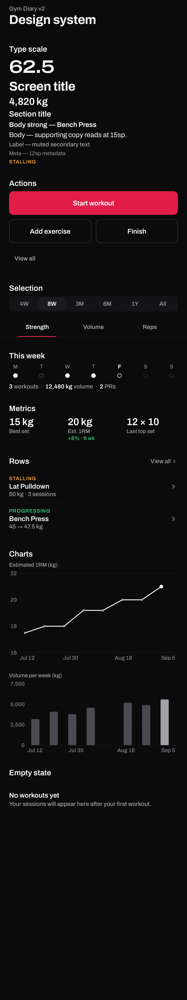

# Design system

The interface is built on a small set of tokens and components in
[`ui/design/`](../app/src/main/java/com/example/gymdiary3/ui/design) and
[`ui/theme/`](../app/src/main/java/com/example/gymdiary3/ui/theme). Token values are also
recorded in [`design-tokens.json`](design-tokens.json).

## Principles

- **Remove before adding.** A component gets a container only when the container means
  something: the one primary action, an input, a chart's plot area. Everything else is type,
  spacing and hairline dividers.
- **One accent, used sparingly.** Crimson marks the primary action, the active state,
  personal records and a selected chart point, and nothing else.
- **Colour carries one meaning each.** Green means progress, orange means attention, blue
  is neutral information, red means a regression or a destructive action.
- **Numbers are honest.** Charts always show axis titles, units and dates. Bars start at
  zero, and a minimum value span keeps small fluctuations from looking like trends.
- **Motion explains change.** Nothing loops or animates on idle, and every animation
  respects the system's reduced-motion setting.

## Colour

| Role | Value | Use |
| --- | --- | --- |
| `bg` | `#0B0B0C` | Window background |
| `surface` | `#141416` | Inputs, the primary-action block |
| `surface-raised` | `#1C1C1F` | Dialogs, selected segments |
| `border` / `border-strong` | `#242427` / `#34343A` | Hairline dividers |
| `border-input` | `#686870` | Control boundaries (meets 3:1) |
| `text` / `text-muted` / `text-faint` | `#F4F4F5` / `#A1A1A8` / `#85858D` | Text hierarchy |
| `accent` / `accent-text` | `#E11D48` / `#FB6A85` | Primary action, active state, PRs |
| `positive` | `#3CCB7F` | Progressing, gains |
| `warning` | `#F2A33A` | Stalling, needs attention |
| `info` | `#6AB0F5` | Stable, neutral information |
| `danger` | `#F26464` | Regressing, destructive actions |

Every text and background pair in use meets WCAG AA (4.5:1 for body text, 3:1 for large
text and control boundaries).

## Typography

Archivo (variable, SIL Open Font License) throughout. The expanded width (125) is used
only for a screen's single hero number.

| Style | Size / line | Weight | Use |
| --- | --- | --- | --- |
| hero | 40 / 44 | 600 | One headline number per screen (tabular) |
| title | 28 / 34 | 700 | Screen titles |
| metric | 22 / 26 | 600 | Figures in metric rows (tabular) |
| section | 17 / 22 | 600 | Section titles, sentence case |
| body / body-strong | 15 / 22 | 400 / 600 | Row titles and text |
| label | 13 / 18 | 500 | Secondary text |
| meta | 12 / 16 | 500 | Metadata; uppercase overlines for status |

## Spacing and shape

- Spacing scale (dp): 4, 8, 12, 16, 20, 24, 32, 40, 56. The page gutter is 20.
- Rows are at least 56dp tall, touch targets at least 48dp, buttons 52dp.
- Radii: 6 (small), 10 (medium), 14 (large).
- Content is capped at 600dp wide and centred on tablets and in landscape.

## Components

| Component | Purpose |
| --- | --- |
| `ScreenHeader` | Tab-level title with optional subtitle and trailing action |
| `DetailTopBar` | Back, title and actions for pushed screens; long titles ellipsize |
| `SectionHeader` | Sentence-case section title with an optional quiet link |
| `ListRow` | The standard row: overline, title, subtitle, detail line, leading and trailing slots |
| `Metric` / `MetricRow` | A figure over a muted label, with no container |
| `StatusLabel` | Uppercase status in one semantic colour (Progressing, Stable, Stalling, Regressing) |
| `PrimaryButton` | One per screen; solid accent, no gradient |
| `SecondaryButton` / `TextAction` | Outlined and text-only actions |
| `SegmentedControl` | Range selectors (4W · 8W · 3M · 6M · 1Y · All, 7D · 30D …) |
| `UnderlineTabs` | Strength / Volume / Reps tabs on exercise detail |
| `WeekStrip` | Monday–Sunday activity dots |
| `LabeledBar` | Proportion bars for recovery, training balance and volume by muscle |
| `TimeSeriesChart` | Line or bar chart on a real time axis, with tap-to-inspect |
| `RestTimerBar`, `ValueStepper`, `RpePicker` | Set-logging controls |
| `EmptyMessage` | Left-aligned empty state with one line of guidance and an optional action |

## Motion

| Token | Duration | Used for |
| --- | --- | --- |
| Fast | 120 ms | Fade-outs |
| Base | 200 ms | Selection changes, list row insert and reflow, set check-mark |
| Slow | 300 ms | Screen transitions, week-strip fill, changed numbers |
| Chart | 450 ms | Chart draw-in and bar fills |
| Highlight | 1600 ms | The fading highlight on a new personal record |

Easing is `cubic-bezier(0.2, 0, 0, 1)`. With reduced motion enabled, transitions are
instant or fade-only. Haptics mark a logged set, a new personal record and the end of a
rest period.

## Accessibility

- Every icon-only control has a content description.
- Charts expose a spoken summary (for example "Estimated 1RM, 8 sessions").
- Layouts are checked at 360dp with text at 130% and at tablet width; see
  [`screenshots/responsive`](screenshots/responsive).
